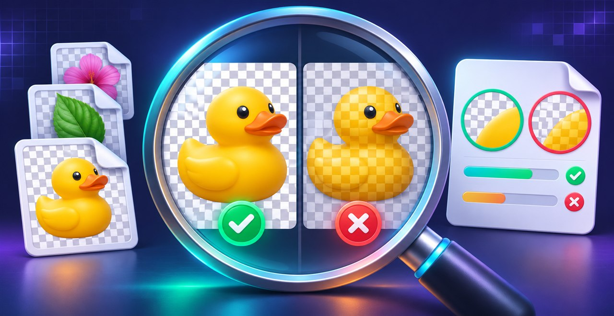
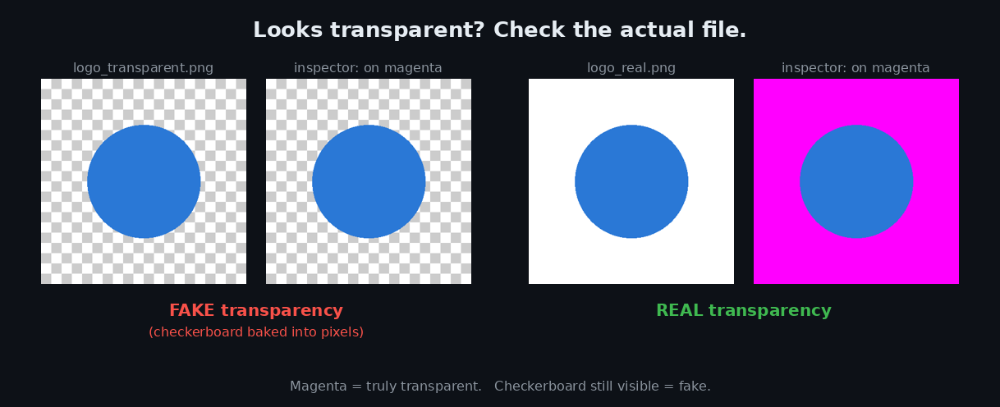
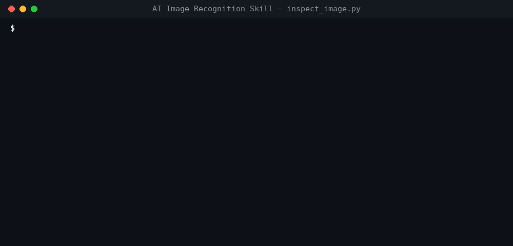

# AI Image Recognition Skill — हिंदी गाइड

> English: [README.md](README.md)



[](https://github.com/i-smiling-buddha/ai-image-recognition-skill/stargazers)
[](LICENSE)
[](https://www.python.org/)
[](https://skills.sh/)
[](https://skills.sh/i-smiling-buddha/ai-image-recognition-skill)

**अंदाज़ा मत लगाइए। असली image file को inspect कीजिए।**

AI vision यह बता सकता है कि image में क्या दिख रहा है, लेकिन original file के अंदर छिपी हर property भरोसे से नहीं बता सकता। यह open-source Agent Skill compatible AI coding agents को एक local Python image inspector देती है। इससे agent खुद file से check कर सकता है कि transparency असली है या नहीं, file का असली format क्या है, और dimensions, DPI, colors, sharpness के संकेत, animation और privacy से जुड़ा metadata क्या है।

AI-generated images, design handoffs, transparent PNGs, website assets, app screenshots, print/merch की तैयारी और product photography के लिए उपयोगी।



## Install

Open Agent Skills CLI से install करें:

```bash
npx skills add i-smiling-buddha/ai-image-recognition-skill
```

पूछे जाने पर अपना target agent चुनें। पूरे ecosystem के लिए [Skills directory](https://skills.sh/) देखें।

## यह क्या check करता है

| Check | आपको क्या मिलता है |
|---|---|
| **असली transparency** | काम की alpha transparency, बेकार alpha channels, और opaque pixels में बना हुआ नकली checkerboard पहचानता है |
| **असली file format** | Image का detect हुआ format उसके filename extension से मिलाता है |
| **Dimensions और print** | Pixel dimensions, megapixels, aspect ratio, embedded DPI, और 300 DPI पर अनुमानित print size |
| **Colors** | Dominant colors के hex values, grayscale detection, और संभावित edge/background color |
| **Image quality** | Heuristic sharpness score, और धुंधली या एक-रंग की images पर warning |
| **Animation** | Frame count और frame timing (जहाँ उपलब्ध हो) |
| **Metadata और privacy** | Camera/software/date metadata, और GPS metadata होने पर warning |
| **Visual previews** | Image को magenta और black background पर रखकर दिखाता है, ताकि transparent हिस्से आसानी से दिखें |

## Example tasks

अपने AI agent से पूछें:

- “क्या यह PNG सच में transparent है, या checkerboard image का ही हिस्सा है?”
- “Check करो कि यह image 300-DPI print के लिए काफ़ी बड़ी है या नहीं।”
- “Dominant colors निकालो और उनके hex codes दो।”
- “क्या इस photo में GPS metadata है जिसे share करने से पहले हटाना चाहिए?”
- “Check करो कि file extension उसके असली image format से match करता है या नहीं।”
- “क्या यह image animated है, और इसमें कितने frames हैं?”

यह skill **programmatic file facts** को visual interpretation के साथ जोड़ती है। Exact properties के लिए script की report इस्तेमाल करें, और image में क्या दिख रहा है यह समझने के लिए agent की vision।

## AI agent के बिना inspector चलाना

ज़रूरत: Python 3 और Pillow। NumPy optional है; उससे sharpness estimate मिलता है। Dependencies अलग रखने के लिए virtual environment इस्तेमाल करें।

```bash
# Create a virtual environment
python -m venv .venv

# Windows PowerShell
.venv\Scripts\Activate.ps1

# macOS / Linux (use this instead of the Windows command)
source .venv/bin/activate

# Install dependencies
python -m pip install pillow
# Optional: python -m pip install numpy

# Inspect one or more images
python scripts/inspect_image.py path/to/image.png --out previews

# Get machine-readable JSON
python scripts/inspect_image.py path/to/image.png --json
```



Example path की जगह अपनी image का path डालें। Script दी गई image पढ़ती है और output folder में magenta/black preview images लिखती है।

## Compatibility

यह repository open [Agent Skills format](https://agentskills.io/) follow करती है। यह उन compatible agents और tools के लिए बनी है जो `SKILL.md` load कर सकें, local Python चला सकें, और target image file तक पहुँच सकें। Skills CLI इसे supported agents में install कर सकता है; exact support और install location हर tool में अलग होती है।

जिस chat app में skill loader नहीं है, उसमें `SKILL.md` को instructions के रूप में दें, और ध्यान रखें कि agent के पास code execution हो और `scripts/inspect_image.py` व image file दोनों तक पहुँच हो।

## ज़रूरी सीमाएँ

- Checkerboard detection, संभावित background detection और sharpness **heuristics** हैं, guarantee नहीं। जब फ़र्क मायने रखता हो, तो previews और image खुद देख लें।
- Sharpness score तभी मिलता है जब NumPy installed हो और image उस calculation के लायक हो।
- Print-size का अनुमान 300 DPI पर आधारित है; यह print quality की guarantee नहीं है।
- Metadata मिलेगा या नहीं, यह image format और file में embedded metadata पर निर्भर करता है।
- Inspector original image को edit या overwrite नहीं करता। Generated reports share करने से पहले देख लें।

**Privacy note:** image metadata से पता चल सकता है कि photo कहाँ ली गई थी। अगर GPS metadata report हो, तो image publish करने से पहले उसे हटाने पर विचार करें।

## Smiling Buddha की और free skills

- **[Smart Model Router Skill](https://github.com/i-smiling-buddha/smart-model-router-skill)** — tokens और API credits बचाइए: आपका agent हर coding task को उस सबसे सस्ते model पर भेजता है जो उसे भरोसे से कर सके, result verify करता है, और fail होने पर ही बड़े model पर जाता है। `npx skills add i-smiling-buddha/smart-model-router-skill`

## Contributing

Issues, bug reports, test images (personal metadata हटाकर), और pull requests का स्वागत है। कृपया public issues में private या sensitive images upload न करें। Guidelines के लिए [CONTRIBUTING.md](CONTRIBUTING.md) देखें।

## License

MIT. Made by [Smiling Buddha](https://github.com/i-smiling-buddha) · [DESITechnology](https://desitechnology.com).
