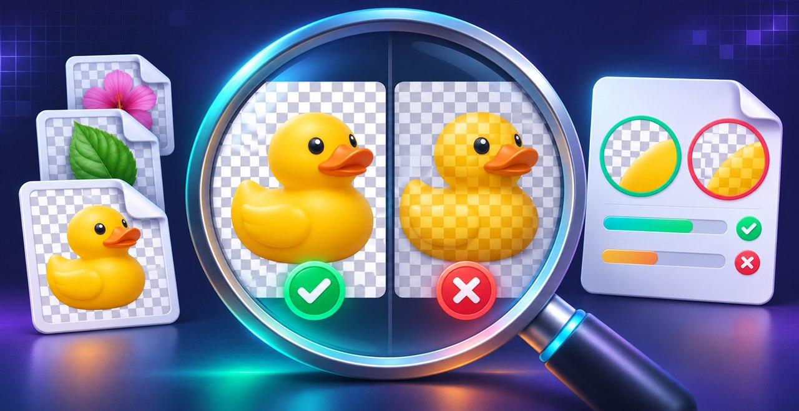
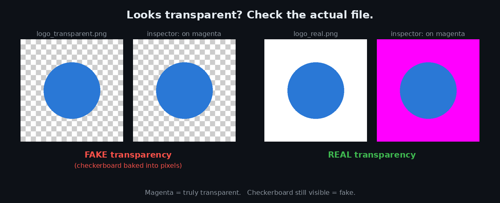
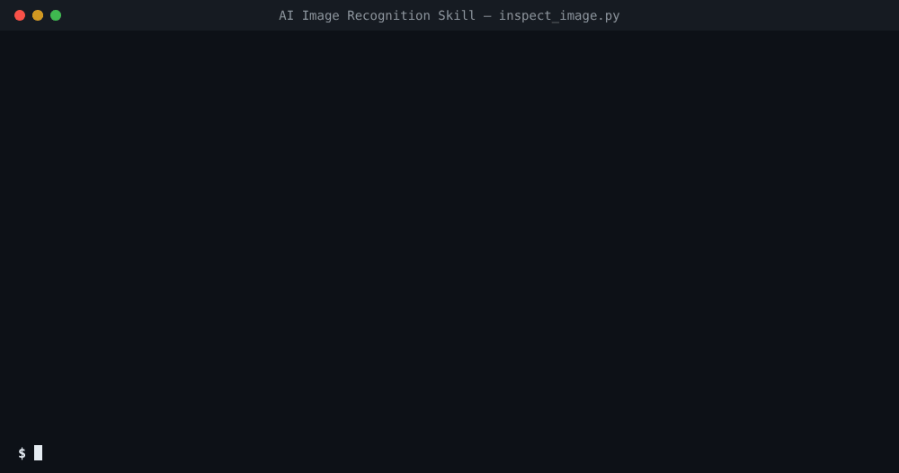

# AI Image Recognition Skill



[](https://github.com/i-smiling-buddha/ai-image-recognition-skill/stargazers)
[](LICENSE)
[](https://www.python.org/)
[](https://skills.sh/)
[](https://skills.sh/i-smiling-buddha/ai-image-recognition-skill)

**Stop guessing. Inspect the actual image file.**

हिंदी गाइड: **[README.hi.md](README.hi.md)**

AI vision can describe what an image looks like, but it cannot reliably tell you every property hidden in the original file. This open-source Agent Skill gives compatible AI coding agents a local Python image inspector so they can verify transparency, true file format, dimensions, DPI, colors, sharpness hints, animation, and privacy-related metadata using the file itself.

Useful for AI-generated images, design handoffs, transparent PNGs, website assets, app screenshots, print/merch preparation, and product photography.





## Install

Install with the open Agent Skills CLI:

```bash
npx skills add i-smiling-buddha/ai-image-recognition-skill
```

Choose your target agent when prompted. See the [Skills directory](https://skills.sh/) for the wider ecosystem.

## What it checks

| Check | What you get |
|---|---|
| **Real transparency** | Detects usable alpha transparency, unused alpha channels, and likely checkerboards baked into opaque pixels |
| **True file format** | Compares the image's detected format with its filename extension |
| **Dimensions & print** | Pixel dimensions, megapixels, aspect ratio, embedded DPI, and estimated print dimensions at 300 DPI |
| **Colors** | Dominant colors as hex values, grayscale detection, and likely edge/background color |
| **Image quality** | A heuristic sharpness score and warnings for likely blurry or solid images |
| **Animation** | Frame count and frame timing where available |
| **Metadata & privacy** | Camera/software/date metadata and a warning when GPS metadata is present |
| **Visual previews** | Composites the image over magenta and black so transparent areas are easy to inspect |

## Example tasks

Ask your AI agent:

- “Is this PNG genuinely transparent, or is the checkerboard part of the image?”
- “Check whether this image is large enough for a 300-DPI print.”
- “Find the dominant colors and give me their hex codes.”
- “Does this photo contain GPS metadata I should remove before sharing?”
- “Check whether the file extension matches its real image format.”
- “Is this image animated, and how many frames does it contain?”

The skill combines **programmatic file facts** with visual interpretation. Use the script's report for exact properties and the agent's vision for understanding the depicted content.

## Run the inspector without an AI agent

Requirements: Python 3 and Pillow. NumPy is optional; it adds the sharpness estimate. Use a virtual environment to keep dependencies isolated.

```bash
# Create a virtual environment
python -m venv .venv

# Windows PowerShell
.venv\Scripts\Activate.ps1

# macOS / Linux (use this instead of the Windows command)
source .venv/bin/activate

# Install dependencies
python -m pip install pillow
# Optional: python -m pip install numpy

# Inspect one or more images
python scripts/inspect_image.py path/to/image.png --out previews

# Get machine-readable JSON
python scripts/inspect_image.py path/to/image.png --json
```


Replace the example path with your image path. The script reads the supplied image and writes magenta/black preview images to the output directory.

Text and JSON reports show whether an ICC profile is embedded and include its description when Pillow can read it, for example sRGB or Display P3. Colours can shift on the web when a platform strips the profile or a browser or display cannot reproduce the image's colour gamut. The inspector reports the profile without converting the image's colours.

### AVIF and HEIC support

The inspector uses the decoders available to Pillow. JPEG and PNG work with standard Pillow installations. Many Pillow wheels include AVIF decoding starting with Pillow 11.3. Use `python -m PIL` to check whether your build lists AVIF support. See [Pillow's AVIF release notes](https://pillow.readthedocs.io/en/stable/releasenotes/11.3.0.html#avif-support-in-wheels).

For HEIC, install `pillow-heif` and register its decoder in the same Python process that runs the inspector. Run these commands from the repository root with your virtual environment active. See the [pillow-heif plugin documentation](https://pillow-heif.readthedocs.io/en/stable/pillow-plugin.html).

```bash
python -m pip install pillow-heif
python -c "import runpy; from pillow_heif import register_heif_opener; register_heif_opener(); runpy.run_path('scripts/inspect_image.py', run_name='__main__')" photo.heic --out previews
```

If Pillow cannot open a file, the text report shows `ERROR:` with the underlying message, such as `cannot identify image file`. With `--json`, that file's entry contains `file` and `error`. Other input files are still processed.

## Compatibility

This repository follows the open [Agent Skills format](https://agentskills.io/). It is designed for compatible agents and tools that can load a `SKILL.md`, run local Python, and access the target image file. The Skills CLI can install it into supported agents; exact support and installation locations vary by tool.

For a chat app without a skill loader, provide `SKILL.md` as the instructions and make sure the agent has code execution plus access to both `scripts/inspect_image.py` and the image file.

## Important limitations

- Checkerboard detection, likely-background detection, and sharpness are **heuristics**, not guarantees. Review the previews and image when the distinction matters.
- A sharpness score is only produced when NumPy is installed and the image is suitable for the calculation.
- Print-size estimates are based on 300 DPI; they do not guarantee print quality.
- Metadata availability depends on the image format and the metadata embedded in the file.
- The inspector does not edit or overwrite the original image. Review generated reports before sharing them.

**Privacy note:** image metadata can reveal where a photo was taken. If GPS metadata is reported, consider removing it before publishing the image.

## More free skills by Smiling Buddha

- **[Smart Model Router Skill](https://github.com/i-smiling-buddha/smart-model-router-skill)** — save tokens and API credits: your agent routes each coding task to the cheapest model that can reliably do it, verifies the result, and escalates only when it fails. `npx skills add i-smiling-buddha/smart-model-router-skill`
- **[Reflection Skill](https://github.com/i-smiling-buddha/reflection-skill)** — recreate any app, website, game or software, clean-room: your agent studies it from the outside, maps every screen, flow and data table, then builds a better version under your own brand. `npx skills add i-smiling-buddha/reflection-skill`
- **[PPT Animation Skill](https://github.com/i-smiling-buddha/ppt-animation-skill)** — turn any topic into a Kurzgesagt-style animated explainer video: your agent writes the script, records an offline Hindi/English voiceover, animates every scene in SVG and renders a 1080p MP4, with no paid APIs. `npx skills add i-smiling-buddha/ppt-animation-skill`
- **[Countdown Video Skill](https://github.com/i-smiling-buddha/countdown-video-skill)** — rank anything and count it down: your agent researches the ranking with sources, then renders Top-N countdowns or year-by-year evolution videos with animated cards, trailer clips, music and YouTube chapters. `npx skills add i-smiling-buddha/countdown-video-skill`

## Contributing

Issues, bug reports, test images (with personal metadata removed), and pull requests are welcome. Please avoid uploading private or sensitive images in public issues. See [CONTRIBUTING.md](CONTRIBUTING.md) for guidelines.

## License

MIT. Made by [Smiling Buddha](https://github.com/i-smiling-buddha) · [DESITechnology](https://desitechnology.com).
