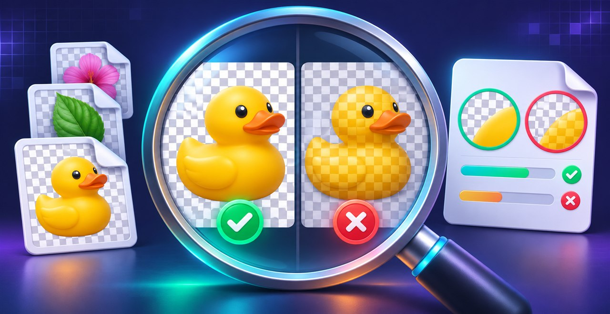

# AI Image Recognition Skill



Check an image file's actual properties with a small local Python script. The skill helps an AI agent inspect transparency, file format, dimensions, color, image quality, animation, and metadata instead of guessing from a chat preview.

**Useful for:** checking whether a PNG has real transparency or a checkerboard drawn into it, catching an image whose extension does not match its format, and seeing metadata that may include GPS coordinates.

## Quick install

With the open Agent Skills CLI:

```bash
npx skills add i-smiling-buddha/ai-image-recognition-skill
```

Choose the agent you want to install it for when prompted. The repository also includes a standalone Python script, so you can use the image checks without an agent skill loader.

## What it checks

| Image property | What the report shows |
|---|---|
| Transparency | Real alpha transparency, no transparency, unused alpha, or a likely checkerboard baked into the pixels; transparent percentage and subject bounds |
| File format | Detected format compared with the filename extension |
| Dimensions | Pixel dimensions, megapixels, aspect ratio, DPI, and estimated print size at 300 DPI |
| Color | Dominant colors, likely background color, and grayscale check |
| Quality | Sharpness estimate and warnings for likely blur or blank/solid images |
| Animation | Frame count and frame timing for animated formats |
| Metadata | Available camera, software, date, and a warning when GPS location metadata is present |
| Previews | Output images composited on magenta and black to make transparent areas visible |

## Run the script directly

Requires Python 3 and Pillow. NumPy is optional. A virtual environment keeps the install separate from system Python.

```bash
python -m venv .venv
# Windows: .venv\Scripts\activate
# macOS/Linux: source .venv/bin/activate
python -m pip install pillow
# Optional: python -m pip install numpy
python scripts/inspect_image.py path/to/image.png --out previews
```

Add `--json` for machine-readable output. Replace the example image path with your own file. The script reads the supplied image and writes its report previews to the output folder.

## Use with other agents

This repository follows the open Agent Skills format. The same skill can be installed in compatible tools such as Codex, Claude Code, Cursor, Gemini CLI, and GitHub Copilot. The exact install location depends on the agent; the Skills CLI can configure supported agents for you.

For a chat app without a skill loader, provide `SKILL.md` as instructions and enable code execution. The agent needs access to `scripts/inspect_image.py` and the image file to inspect it.

## Limits

Sharpness and likely-background results are estimates to guide review, not definitive judgments about image quality or subject matter. Check the image visually when the distinction matters. Image metadata can contain personal location information; review the report before sharing it.

## License

MIT. Made by [Smiling Buddha](https://github.com/i-smiling-buddha) · Chandoriya Technology.
